<picture><source media="(prefers-color-scheme: dark)" srcset="assets/hero-dark.svg"></picture>

<picture><source media="(prefers-color-scheme: dark)" srcset="assets/about-dark.svg"></picture>

<picture><source media="(prefers-color-scheme: dark)" srcset="assets/stack-dark.svg"></picture>

<a href="https://github.com/KaanAlper/logical-lunge"><picture><source media="(prefers-color-scheme: dark)" srcset="assets/project-logical-lunge-dark.svg"></picture></a>&nbsp;<a href="https://github.com/KaanAlper/Aegis-Authleniticator-Linux"><picture><source media="(prefers-color-scheme: dark)" srcset="assets/project-aegis-authleniticator-linux-dark.svg"></picture></a>

<a href="https://github.com/KaanAlper/ByteForge"><picture><source media="(prefers-color-scheme: dark)" srcset="assets/project-byteforge-dark.svg"></picture></a>&nbsp;<a href="https://github.com/KaanAlper/AsenaPlug"><picture><source media="(prefers-color-scheme: dark)" srcset="assets/project-asenaplug-dark.svg"></picture></a>

<picture><source media="(prefers-color-scheme: dark)" srcset="assets/activity-dark.svg"></picture>

<picture><source media="(prefers-color-scheme: dark)" srcset="assets/streak-dark.svg"></picture>

<picture><source media="(prefers-color-scheme: dark)" srcset="https://raw.githubusercontent.com/KaanAlper/KaanAlper/output/snake-dark.svg"></picture>

<picture><source media="(prefers-color-scheme: dark)" srcset="assets/dock-dark.svg"></picture>

<a href="https://kaanalper.github.io"><picture><source media="(prefers-color-scheme: dark)" srcset="assets/button-0-dark.svg"></picture></a>&nbsp;<a href="https://github.com/KaanAlper?tab=repositories"><picture><source media="(prefers-color-scheme: dark)" srcset="assets/button-1-dark.svg"></picture></a>&nbsp;<a href="https://www.instagram.com/kaan__alper/"><picture><source media="(prefers-color-scheme: dark)" srcset="assets/social-instagram-dark.svg"></picture></a>&nbsp;<a href="https://x.com/Kaan__Alper"><picture><source media="(prefers-color-scheme: dark)" srcset="assets/social-x-dark.svg"></picture></a>&nbsp;<a href="https://anilist.co/user/KaanAlper/"><picture><source media="(prefers-color-scheme: dark)" srcset="assets/social-anilist-dark.svg"></picture></a>&nbsp;<a href="https://steamcommunity.com/id/kaanalper"><picture><source media="(prefers-color-scheme: dark)" srcset="assets/social-steam-dark.svg"></picture></a>

