

<picture><source media="(prefers-color-scheme: dark)" srcset="assets/banner-dark.svg"></picture>
<picture><source media="(prefers-color-scheme: dark)" srcset="assets/typing-dark.svg"></picture>

<a href="https://www.instagram.com/kaan__alper/"><picture><source media="(prefers-color-scheme: dark)" srcset="assets/social-0-dark.svg"></picture></a>&nbsp;<a href="https://x.com/Kaan__Alper"><picture><source media="(prefers-color-scheme: dark)" srcset="assets/social-1-dark.svg"></picture></a>&nbsp;<a href="https://anilist.co/user/KaanAlper/"><picture><source media="(prefers-color-scheme: dark)" srcset="assets/social-2-dark.svg"></picture></a>&nbsp;<a href="https://steamcommunity.com/id/kaanalper"><picture><source media="(prefers-color-scheme: dark)" srcset="assets/social-3-dark.svg"></picture></a>&nbsp;<a href="mailto:kaanalperkaraaslan@gmail.com"><picture><source media="(prefers-color-scheme: dark)" srcset="assets/social-4-dark.svg"></picture></a>

<a href="https://kaanalper.github.io"><picture><source media="(prefers-color-scheme: dark)" srcset="assets/button-0-dark.svg"></picture></a>&nbsp;<a href="https://github.com/KaanAlper?tab=repositories"><picture><source media="(prefers-color-scheme: dark)" srcset="assets/button-1-dark.svg"></picture></a>

 

<picture><source media="(prefers-color-scheme: dark)" srcset="assets/prompt-about-dark.svg"></picture>
<picture><source media="(prefers-color-scheme: dark)" srcset="assets/fetch-dark.svg"></picture>

 

<picture><source media="(prefers-color-scheme: dark)" srcset="assets/prompt-stack-dark.svg"></picture>
<picture><source media="(prefers-color-scheme: dark)" srcset="assets/stack-dark.svg"></picture>

 

<picture><source media="(prefers-color-scheme: dark)" srcset="assets/prompt-featured-dark.svg"></picture>

<a href="https://github.com/KaanAlper/logical-lunge"><picture><source media="(prefers-color-scheme: dark)" srcset="assets/f-logical-lunge-dark.svg"></picture></a>&nbsp;<a href="https://github.com/KaanAlper/Aegis-Authleniticator-Linux"><picture><source media="(prefers-color-scheme: dark)" srcset="assets/f-aegis-authleniticator-linux-dark.svg"></picture></a>

<a href="https://github.com/KaanAlper/ByteForge"><picture><source media="(prefers-color-scheme: dark)" srcset="assets/f-byteforge-dark.svg"></picture></a>&nbsp;<a href="https://github.com/KaanAlper/AsenaPlug"><picture><source media="(prefers-color-scheme: dark)" srcset="assets/f-asenaplug-dark.svg"></picture></a>

 

<picture><source media="(prefers-color-scheme: dark)" srcset="assets/prompt-ws-dark.svg"></picture>

<picture><source media="(prefers-color-scheme: dark)" srcset="assets/ws-1-dark.svg"></picture>

<a href="https://github.com/KaanAlper/illogical-impulse-kaan-custom"><picture><source media="(prefers-color-scheme: dark)" srcset="assets/c-illogical-impulse-kaan-custom-dark.svg"></picture></a>&nbsp;<a href="https://github.com/KaanAlper/hypr-droid"><picture><source media="(prefers-color-scheme: dark)" srcset="assets/c-hypr-droid-dark.svg"></picture></a>

<a href="https://github.com/KaanAlper/sudo-for-windows"><picture><source media="(prefers-color-scheme: dark)" srcset="assets/c-sudo-for-windows-dark.svg"></picture></a>&nbsp;<a href="https://github.com/KaanAlper/bt-tray-win"><picture><source media="(prefers-color-scheme: dark)" srcset="assets/c-bt-tray-win-dark.svg"></picture></a>

<picture><source media="(prefers-color-scheme: dark)" srcset="assets/ws-2-dark.svg"></picture>

<a href="https://github.com/KaanAlper/AsenaDPI"><picture><source media="(prefers-color-scheme: dark)" srcset="assets/c-asenadpi-dark.svg"></picture></a>&nbsp;<a href="https://github.com/KaanAlper/AsenaScale"><picture><source media="(prefers-color-scheme: dark)" srcset="assets/c-asenascale-dark.svg"></picture></a>

<a href="https://github.com/KaanAlper/ConnectSync"><picture><source media="(prefers-color-scheme: dark)" srcset="assets/c-connectsync-dark.svg"></picture></a>&nbsp;<a href="https://github.com/KaanAlper/Asenaizer"><picture><source media="(prefers-color-scheme: dark)" srcset="assets/c-asenaizer-dark.svg"></picture></a>

<picture><source media="(prefers-color-scheme: dark)" srcset="assets/ws-3-dark.svg"></picture>

<a href="https://github.com/KaanAlper/Dimenced"><picture><source media="(prefers-color-scheme: dark)" srcset="assets/c-dimenced-dark.svg"></picture></a>&nbsp;<a href="https://github.com/KaanAlper/Protasena"><picture><source media="(prefers-color-scheme: dark)" srcset="assets/c-protasena-dark.svg"></picture></a>

<a href="https://github.com/KaanAlper/Protasena-library"><picture><source media="(prefers-color-scheme: dark)" srcset="assets/c-protasena-library-dark.svg"></picture></a>&nbsp;<a href="https://github.com/KaanAlper/PDF-Reader"><picture><source media="(prefers-color-scheme: dark)" srcset="assets/c-pdf-reader-dark.svg"></picture></a>

<picture><source media="(prefers-color-scheme: dark)" srcset="assets/ws-4-dark.svg"></picture>

<a href="https://github.com/KaanAlper/UnderRune"><picture><source media="(prefers-color-scheme: dark)" srcset="assets/c-underrune-dark.svg"></picture></a>&nbsp;<a href="https://github.com/KaanAlper/anime-cli"><picture><source media="(prefers-color-scheme: dark)" srcset="assets/c-anime-cli-dark.svg"></picture></a>

<a href="https://github.com/KaanAlper/anikku-extension-repo"><picture><source media="(prefers-color-scheme: dark)" srcset="assets/c-anikku-extension-repo-dark.svg"></picture></a>&nbsp;<a href="https://github.com/KaanAlper/Minecraft-Server-Opener"><picture><source media="(prefers-color-scheme: dark)" srcset="assets/c-minecraft-server-opener-dark.svg"></picture></a>

<picture><source media="(prefers-color-scheme: dark)" srcset="assets/ws-5-dark.svg"></picture>

<a href="https://github.com/KaanAlper/teknofest-2026-sruy"><picture><source media="(prefers-color-scheme: dark)" srcset="assets/c-teknofest-2026-sruy-dark.svg"></picture></a>&nbsp;<a href="https://github.com/KaanAlper/LCD-PC-Temperture-shower-with-Arduino"><picture><source media="(prefers-color-scheme: dark)" srcset="assets/c-lcd-pc-temperture-shower-with-arduino-dark.svg"></picture></a>

<a href="https://github.com/KaanAlper/Facial-Recognition-Attendance-System"><picture><source media="(prefers-color-scheme: dark)" srcset="assets/c-facial-recognition-attendance-system-dark.svg"></picture></a>&nbsp;<a href="https://github.com/KaanAlper/WaydroidOnX11"><picture><source media="(prefers-color-scheme: dark)" srcset="assets/c-waydroidonx11-dark.svg"></picture></a>

 

<picture><source media="(prefers-color-scheme: dark)" srcset="assets/prompt-stats-dark.svg"></picture>
<picture><source media="(prefers-color-scheme: dark)" srcset="assets/stats-dark.svg"></picture>

 

<picture><source media="(prefers-color-scheme: dark)" srcset="assets/prompt-snake-dark.svg"></picture>
<picture><source media="(prefers-color-scheme: dark)" srcset="https://raw.githubusercontent.com/KaanAlper/KaanAlper/output/snake-dark.svg"></picture>

 

<picture><source media="(prefers-color-scheme: dark)" srcset="assets/dock-dark.svg"></picture>

<picture><source media="(prefers-color-scheme: dark)" srcset="assets/statusline-dark.svg"></picture>

Rendered by <a href="scripts/render.py">scripts/render.py</a> from <a href="config.json">config.json</a>, refreshed daily by GitHub Actions.

